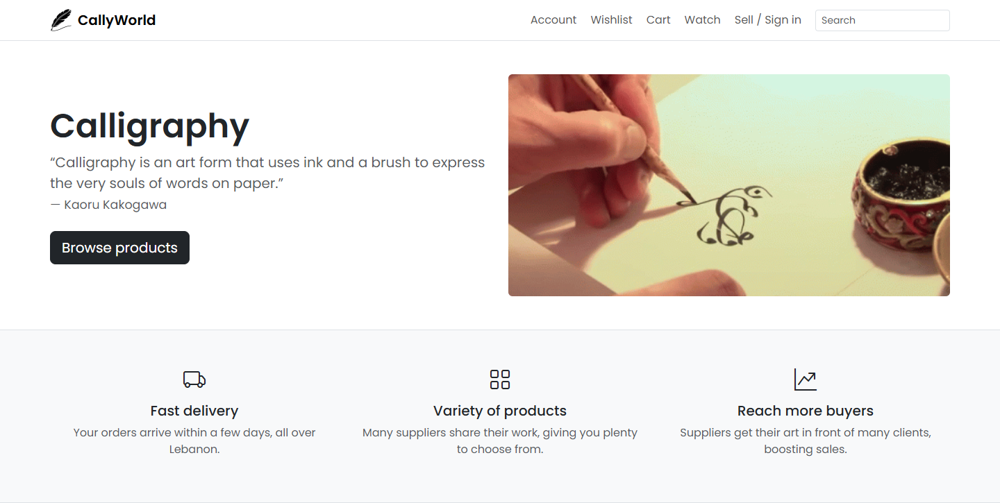
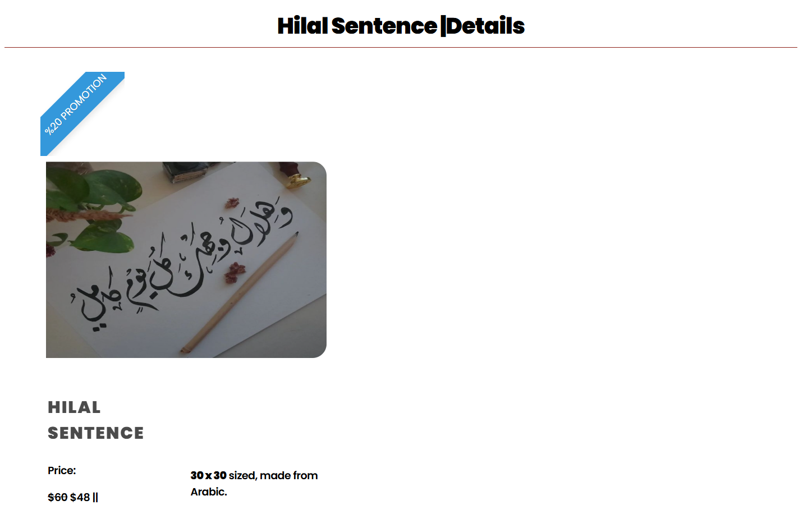
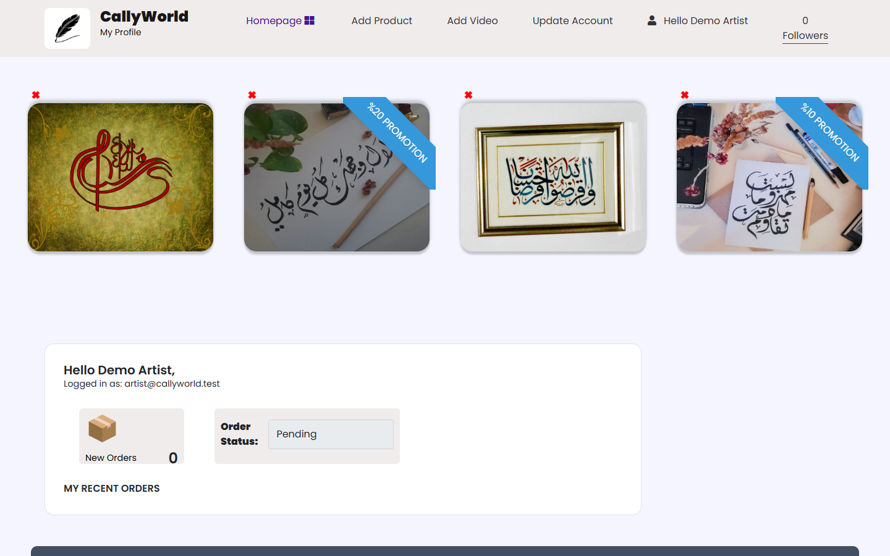
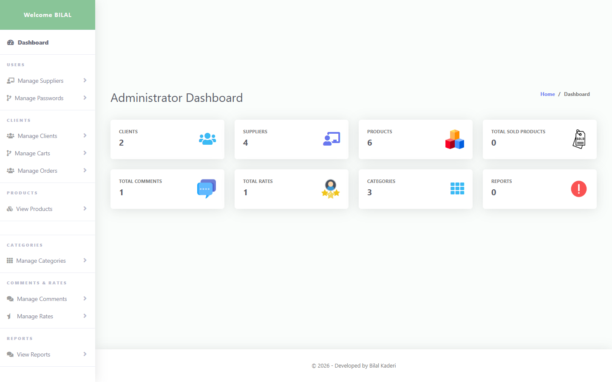

# CallyWorld

CallyWorld is an online marketplace for calligraphy art. Calligraphers open a shop and list their pieces, buyers browse, rate and order them, couriers deliver the orders, and an admin moderates the whole platform.

Built with Laravel 9, MySQL and Bootstrap.



## Features

**Buyers**
- Browse products by category and search
- Product pages with sizes, prices, discounts, ratings and comments
- Wishlist, shopping cart and checkout (cash on delivery or card through Stripe)
- Rate products and artists, follow artists, report artists
- E-mail account verification

**Artists (suppliers)**
- Personal dashboard to add, edit and delete products, set stock and promotions
- Upload short videos of their work for the "Watch" feed
- Manage incoming orders: confirm, mark ready, or cancel
- Sales statistics, followers, and reporting or blocking abusive buyers

**Couriers**
- Separate login to see assigned deliveries and accept or decline them

**Admin**
- Dashboard with platform totals
- Manage suppliers, clients, products, categories, comments and ratings
- Track carts and orders, set delivery dates, send reminders to sellers
- Review user reports

## Screenshots

| Product page | Artist dashboard |
|---|---|
|  |  |



## Tech stack

- **Backend:** PHP 8, Laravel 9 (Eloquent, Blade, middleware, mail)
- **Database:** MySQL / MariaDB with Laravel migrations and seeders
- **Frontend:** Blade templates, Bootstrap 5, jQuery (AJAX), Chart.js
- **Payments:** Stripe PHP SDK

## Getting started

### Requirements

- PHP 8.0.2 or newer (tested with PHP 8.2) with the `pdo_mysql`, `fileinfo` and `openssl` extensions
- [Composer](https://getcomposer.org/download/)
- MySQL or MariaDB (XAMPP works fine on Windows)

Node.js is not needed: the compiled front-end assets are committed in `public/build`.

### Setup

```bash
git clone https://github.com/bilalkaderi/CallyWorld.git
cd CallyWorld

composer install
cp .env.example .env
php artisan key:generate
```

Create an empty database named `callyworld`. If your MySQL user or password differs from `root` with no password, update the `DB_*` values in `.env`. Then run:

```bash
php artisan migrate --seed
php artisan serve
```

Open http://127.0.0.1:8000.

### Demo accounts

The seeder creates these accounts. The password for all of them is `password`.

| Role | Login | Where to sign in |
|---|---|---|
| Admin | `admin@callyworld.test` | `/login` |
| Artist | `artist@callyworld.test` | `/login` |
| Buyer | `buyer@callyworld.test` | Sign-in form on the homepage |
| Courier | `courier` (username) | `/delivery/login` |

The seeder can be run again (`php artisan db:seed`) without creating duplicates.

### Optional configuration

- **E-mail:** by default, verification e-mails are written to `storage/logs/laravel.log` instead of being sent. Set the `MAIL_*` values in `.env` to send real mail.
- **Card payments:** add your Stripe test keys as `STRIPE_KEY` and `STRIPE_SECRET` in `.env`. Everything else works without them.

## Project structure

```
app/Http/Controllers/   AdminController, UserController (artists), ClientController (buyers),
                        DeliveryController, PaymentController, HomeController, CustomAuthController
app/Models/             Eloquent models (Product, Cart, Order, Client, User, ...)
database/migrations/    Database schema
database/seeders/       Demo data
resources/views/        Blade templates (admin/, auth/, delivery/, storefront pages)
routes/web.php          All web routes
```

## Roadmap

- Replace raw SQL queries with Eloquent or query bindings
- Move data access out of Blade views into controllers
- Protect state-changing GET routes with POST and CSRF
- Add feature tests for the order and checkout flow

## Author

Bilal Kaderi
